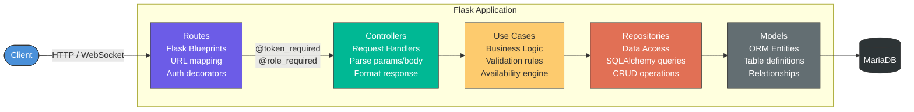
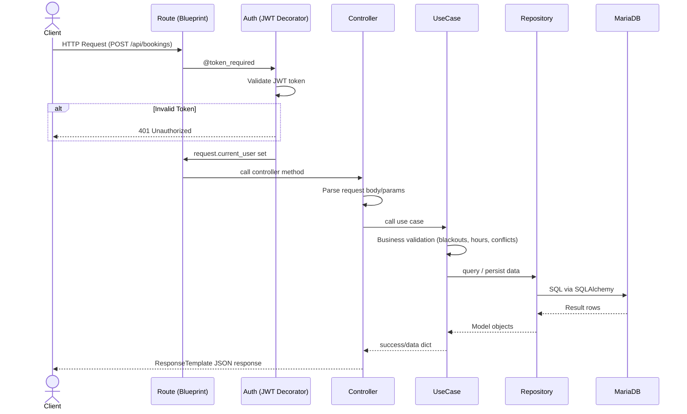
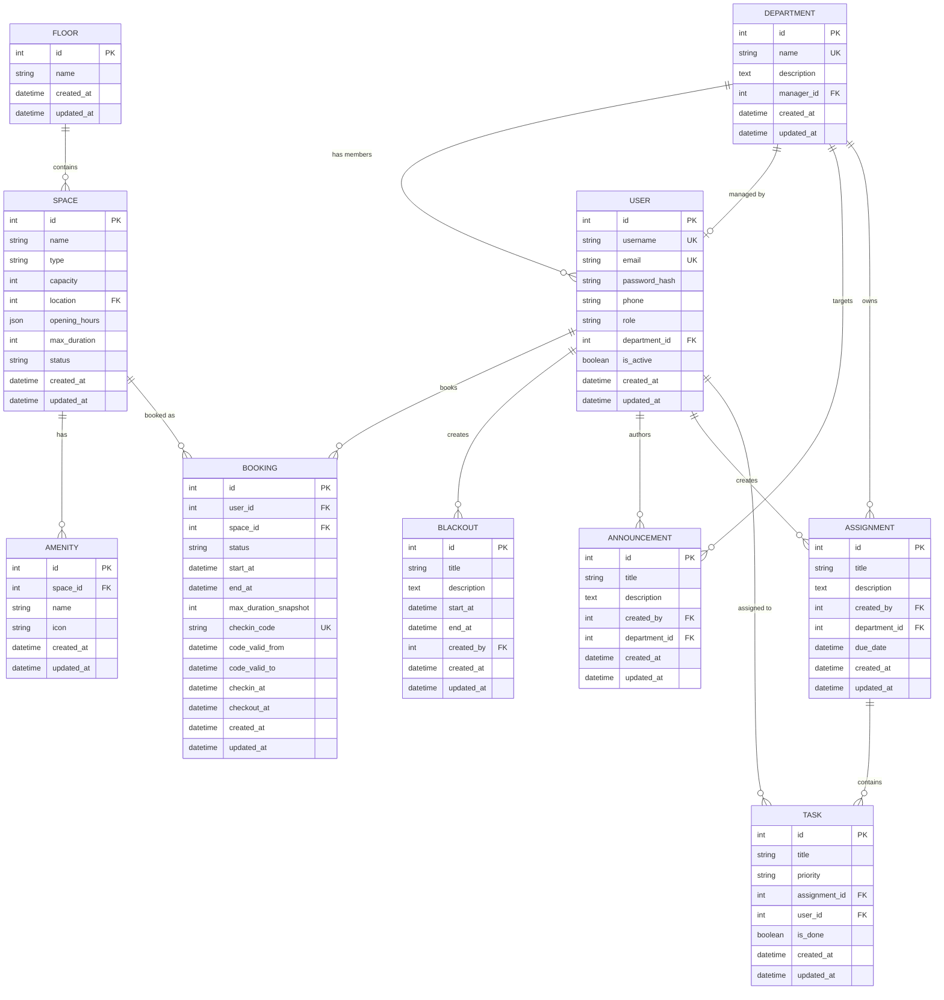

# OpenBO — Office Booking System Backend


A complete backend for an office space booking platform -- manage hot desks, meeting rooms, and private rooms across multi-floor buildings with real-time updates, role-based access control, and a check-in/check-out workflow.

---

## Table of Contents

- [Features](#features)
- [Tech Stack](#tech-stack)
- [Architecture](#architecture)
- [Clean Architecture Layers](#clean-architecture-layers)
- [Request Lifecycle](#request-lifecycle)
- [Data Model](#data-model)
- [Entity-Relationship Diagram](#entity-relationship-diagram)
- [API Endpoints](#api-endpoints)
- [WebSocket Events](#websocket-events)
- [Authentication & Authorization](#authentication--authorization)
- [Response Format](#response-format)
- [Getting Started](#getting-started)
- [Project Structure](#project-structure)
- [Seed Data](#seed-data)

---

## Features

- **Space Booking Engine** -- Book hot desks, meeting rooms, and private rooms with smart availability calculation (per-day opening hours, blackout dates, conflict detection)
- **Check-in / Check-out Workflow** -- Each booking generates a unique check-in code (`CHK-XXXXXXXX`) valid for the booking day; status flows through `active -> checkin -> finished` or `active -> cancelled`
- **Role-Based Access Control** -- Three roles (`employee`, `manager`, `superadmin`) with fine-grained permissions at the route level
- **Department-Scoped Management** -- Managers can only manage users, announcements, assignments, and tasks within their own department
- **Real-Time Updates** -- Socket.IO with three namespaces for live announcements, space availability, and booking changes
- **Announcements** -- Company-wide or department-targeted announcements from managers
- **Assignment & Task Management** -- Lightweight project management: assignments with tasks, priorities, and completion tracking
- **Blackout Dates** -- System-wide blocked periods (holidays, maintenance) that prevent all bookings
- **Statistics Dashboard** -- Weekly booking hours, favorite space, announcement count, and to-do list data per user

---

## Tech Stack

| Component | Technology |
|---|---|
| Language | Python 3.13 |
| Framework | Flask 3.0 |
| Database | MariaDB 11.2 |
| ORM | Flask-SQLAlchemy 3.1 |
| Auth | PyJWT 2.8 (HS256) + bcrypt 4.1 |
| Real-time | Flask-SocketIO 5.3 (threading mode) |
| CORS | Flask-CORS 4.0 |
| Containerization | Docker + Docker Compose 3.8 |
| Reverse Proxy | Nginx |

---

## Architecture

### Clean Architecture Layers

The project follows **Clean Architecture** principles with strict separation of concerns across five layers. Each layer only depends on the layer below it.



| Layer | Directory | Responsibility |
|---|---|---|
| **Routes** | `src/routes/` | Map URLs to controllers, apply auth decorators |
| **Controllers** | `src/controllers/` | Parse request parameters and body, call use cases, wrap results with `ResponseTemplate` |
| **Use Cases** | `src/usecases/` | Business logic -- availability calculation, booking validation, role-based authorization rules |
| **Repositories** | `src/repositories/` | Database access via SQLAlchemy -- abstracted queries behind static methods |
| **Models** | `src/models/` | SQLAlchemy ORM models mapping to MariaDB tables |

### Request Lifecycle

A typical API request flows through all five layers and back:



---

## Data Model

The system has **10 entities** with the following relationships:

### Entity-Relationship Diagram



> **Note:** `USER` and `DEPARTMENT` have a circular foreign key -- `users.department_id -> departments.id` and `departments.manager_id -> users.id` -- resolved with SQLAlchemy's `use_alter` and `post_update=True`.

---

## API Endpoints

All endpoints are prefixed with `/api`. Authenticated routes require `Authorization: Bearer <token>` header.

### Health

| Method | Path | Auth | Description |
|---|---|---|---|
| `GET` | `/api/health` | -- | Server health check |

### Auth

| Method | Path | Auth | Description |
|---|---|---|---|
| `POST` | `/api/auth/login` | -- | Login with username and password, returns JWT |
| `POST` | `/api/auth/register` | -- | Register a new user account |
| `GET` | `/api/auth/me` | Token | Get current authenticated user profile |

### Users

| Method | Path | Auth | Description |
|---|---|---|---|
| `GET` | `/api/users` | Superadmin | List all users |
| `GET` | `/api/users/:id` | Superadmin | Get user by ID |
| `POST` | `/api/users` | Superadmin | Create a user (any role) |
| `PUT` | `/api/users/:id` | Superadmin | Update a user |
| `DELETE` | `/api/users/:id` | Superadmin | Delete a user (cannot delete self) |
| `GET` | `/api/users/department/my-team` | Manager | List users in own department |
| `POST` | `/api/users/department/my-team` | Manager | Create employee in own department |
| `PUT` | `/api/users/department/my-team/:id` | Manager | Update employee in own department |
| `DELETE` | `/api/users/department/my-team/:id` | Manager | Delete employee from own department |

### Departments

| Method | Path | Auth | Description |
|---|---|---|---|
| `GET` | `/api/departments` | Superadmin | List all departments |
| `GET` | `/api/departments/:id` | Superadmin | Get department by ID |
| `POST` | `/api/departments` | Superadmin | Create department |
| `PUT` | `/api/departments/:id` | Superadmin | Update department |
| `DELETE` | `/api/departments/:id` | Superadmin | Delete department (must be empty) |

### Floors

| Method | Path | Auth | Description |
|---|---|---|---|
| `GET` | `/api/floors` | Superadmin | List all floors |
| `GET` | `/api/floors/:id` | Superadmin | Get floor by ID |
| `POST` | `/api/floors` | Superadmin | Create floor |
| `PUT` | `/api/floors/:id` | Superadmin | Update floor |
| `DELETE` | `/api/floors/:id` | Superadmin | Delete floor (must have no spaces) |

### Spaces

| Method | Path | Auth | Description |
|---|---|---|---|
| `GET` | `/api/spaces` | Token | List all spaces (optional `date`, `start_time`, `end_time` filters) |
| `GET` | `/api/spaces/:id` | Token | Get space details with amenities |
| `GET` | `/api/spaces/manage` | Superadmin | List all spaces for admin management |
| `GET` | `/api/spaces/manage/:id` | Superadmin | Get space for admin management |
| `PUT` | `/api/spaces/manage/:id` | Superadmin | Update space status |

### Amenities

| Method | Path | Auth | Description |
|---|---|---|---|
| `GET` | `/api/amenities` | Superadmin | List all amenities |
| `GET` | `/api/amenities/:id` | Superadmin | Get amenity by ID |
| `POST` | `/api/amenities` | Superadmin | Create amenity |
| `PUT` | `/api/amenities/:id` | Superadmin | Update amenity |
| `DELETE` | `/api/amenities/:id` | Superadmin | Delete amenity |

### Blackouts

| Method | Path | Auth | Description |
|---|---|---|---|
| `GET` | `/api/blackouts` | Superadmin | List all blackout periods |
| `GET` | `/api/blackouts/:id` | Superadmin | Get blackout by ID |
| `POST` | `/api/blackouts` | Superadmin | Create blackout period |
| `PUT` | `/api/blackouts/:id` | Superadmin | Update blackout period |
| `DELETE` | `/api/blackouts/:id` | Superadmin | Delete blackout period |

### Bookings

| Method | Path | Auth | Description |
|---|---|---|---|
| `GET` | `/api/bookings` | Token | Get current user's bookings |
| `POST` | `/api/bookings` | Token | Create a new booking |
| `GET` | `/api/bookings/:id` | Token | Get booking by ID |
| `GET` | `/api/bookings/user/:user_id` | Token | Get bookings by user |
| `PATCH` | `/api/bookings/:id` | Token | Update booking status (checkin with code, checkout, cancel) |
| `GET` | `/api/bookings/manage` | Superadmin | List all bookings (admin) |
| `GET` | `/api/bookings/manage/:id` | Superadmin | Get booking by ID (admin) |
| `DELETE` | `/api/bookings/manage/:id` | Superadmin | Delete a booking |

### Announcements

| Method | Path | Auth | Description |
|---|---|---|---|
| `GET` | `/api/announcements` | Manager | Get company-wide + own department announcements |
| `POST` | `/api/announcements` | Manager | Create announcement (own department or company-wide) |
| `PUT` | `/api/announcements/:id` | Manager | Update announcement |
| `DELETE` | `/api/announcements/:id` | Manager | Delete announcement (own department only) |

### Assignments

| Method | Path | Auth | Description |
|---|---|---|---|
| `GET` | `/api/assignments` | Manager | List assignments in own department |
| `POST` | `/api/assignments` | Manager | Create assignment for own department |
| `PUT` | `/api/assignments/:id` | Manager | Update assignment |
| `DELETE` | `/api/assignments/:id` | Manager | Delete assignment (all tasks must be completed) |

### Tasks

| Method | Path | Auth | Description |
|---|---|---|---|
| `GET` | `/api/tasks/assignment/:id` | Manager | List tasks for an assignment |
| `POST` | `/api/tasks/assignment/:id` | Manager | Create task (assign to department member) |
| `PUT` | `/api/tasks/:id` | Manager / Employee | Manager: update all fields; Employee: toggle `is_done` on own tasks |
| `DELETE` | `/api/tasks/:id` | Manager | Delete task (own department) |

### Statistics

| Method | Path | Auth | Description |
|---|---|---|---|
| `GET` | `/api/stats` | Token | Get user stats (announcements, weekly hours, favorite space, to-do list) |

---

## WebSocket Events

Real-time communication uses **Socket.IO** with three namespaces. All namespaces require authentication via an `authenticate` event with `{token}`.

### `/announcements`

| Direction | Event | Description |
|---|---|---|
| Client -> Server | `authenticate` | Send `{token}` -- joins `global_announcements`; superadmins join all dept rooms; others join own dept room |
| Server -> Client | `authenticated` | Confirmation with `user_id`, `role`, `subscribed_to` |
| Server -> Client | `announcements_initial` | Initial announcement list on connect |
| Server -> Client | `created` | New announcement broadcast |
| Server -> Client | `updated` | Updated announcement broadcast |
| Server -> Client | `deleted` | Deleted announcement `{id}` |

### `/spaces`

| Direction | Event | Description |
|---|---|---|
| Client -> Server | `authenticate` | Send `{token}` -- joins `spaces_updates` room |
| Client -> Server | `get_spaces` | Send `{date?, start_time?, end_time?}` -- returns filtered spaces |
| Server -> Client | `spaces_data` | Space list with `{spaces[], count, filters}` |
| Server -> Client | `created` / `updated` / `deleted` | Space change broadcast |
| Server -> Client | `availability_changed` | Booking-triggered availability update |

### `/bookings`

| Direction | Event | Description |
|---|---|---|
| Client -> Server | `authenticate` | Send `{token}` -- joins `user_{id}_bookings`; managers also join `department_{id}_bookings` |
| Client -> Server | `get_bookings` | Send `{token}` -- returns user's bookings (managers see department bookings) |
| Server -> Client | `bookings_data` | Booking list with `{bookings[], count}` |
| Server -> Client | `created` / `updated` / `deleted` | Booking change broadcast |

---

## Authentication & Authorization

### JWT Flow

1. Client sends `POST /api/auth/login` with `{username, password}`
2. Server validates credentials (bcrypt hash comparison), checks `is_active` flag
3. Server returns a JWT token (HS256, **24-hour expiry**)
4. Client includes `Authorization: Bearer <token>` in subsequent requests
5. Token payload: `user_id`, `username`, `email`, `role`, `department_id`, `exp`, `iat`

### Route Protection

Two decorators are applied at the route level:

- **`@token_required`** -- Validates the Bearer token, injects `request.current_user` with user data from the JWT payload
- **`@role_required(roles)`** -- Checks `request.current_user.role` against a list of allowed roles

### Role Permissions

| Role | Capabilities |
|---|---|
| **Employee** | Book spaces, check-in/out, view own bookings and stats, mark own tasks as done |
| **Manager** | All employee abilities + manage own department users, announcements, assignments, and tasks |
| **Superadmin** | Full CRUD on users, departments, floors, spaces, amenities, blackouts; manage all bookings |

---

## Response Format

All API responses follow a standardized JSON envelope:

**Success:**
```json
{
  "success": true,
  "data": { "..." },
  "message": "Operation successful",
  "status_code": 200
}
```

**Error:**
```json
{
  "success": false,
  "message": "Error description",
  "status_code": 400
}
```

Global error handlers are registered for HTTP 400, 401, 403, 404, 405, 422, 500, SQLAlchemy errors, and unhandled exceptions.

---

## Getting Started

### Prerequisites

- Python 3.13+
- MariaDB 11.2+ (or MySQL 8+)
- Docker and Docker Compose (optional)

### Local Development

```bash
# Clone and enter project
git clone <repo-url>
cd backend

# Create virtual environment
python -m venv venv
source venv/bin/activate   # Linux/Mac
venv\Scripts\activate      # Windows

# Install dependencies
pip install -r requirements.txt

# Configure environment
cp .env.docker .env
# Edit .env with your database credentials:
#   DB_HOST=localhost
#   DB_PORT=3306
#   DB_NAME=openbo
#   DB_USER=root
#   DB_PASSWORD=your_password
#   JWT_SECRET_KEY=your_secret

# Run migrations (creates/resets all tables)
python migrate.py

# Seed initial data
python seed.py

# Start development server
python run.py
# Server runs at http://localhost:5000
```

### Docker

```bash
# Build and start all services (MariaDB + Backend)
docker-compose up --build

# The compose file automatically runs:
#   1. migrate.py  (create tables)
#   2. seed.py     (insert demo data)
#   3. run.py      (start server)
```

The Docker setup includes:
- **MariaDB 11.2** on port 3306 with persistent volume
- **Backend** on port 5000 with health check dependency on the database
- **Production Dockerfile** with multi-stage build and HEALTHCHECK on `/api/health`
- **Nginx config** for reverse proxy with WebSocket upgrade support

---

## Project Structure

```
backend/
|-- run.py                        # Application entrypoint
|-- migrate.py                    # Database migration (drop + recreate)
|-- seed.py                       # Seed script (demo data)
|-- requirements.txt              # Python dependencies
|-- Dockerfile                    # Development Docker image
|-- Dockerfile.production         # Multi-stage production image
|-- docker-compose.yaml           # MariaDB + Backend orchestration
|-- nginx.conf                    # Nginx reverse proxy config
|
+-- src/
    |-- app.py                    # Flask app factory, blueprint registration
    |-- config/
    |   |-- config.py             # App configuration (env vars)
    |   |-- database.py           # SQLAlchemy instance
    |   +-- socketio.py           # SocketIO instance
    |-- routes/                   # Flask Blueprints (URL to Controller mapping)
    |-- controllers/              # Request parsing, response formatting
    |-- usecases/                 # Business logic layer
    |-- repositories/             # Data access layer (SQLAlchemy queries)
    |-- models/                   # ORM model definitions (10 entities)
    |-- utils/
    |   |-- jwt_helper.py         # @token_required, @role_required decorators
    |   |-- response_template.py  # Standardized JSON response builder
    |   +-- error_handlers.py     # Global HTTP error handlers
    +-- websocket/
        |-- announcement_socket.py  # /announcements namespace
        |-- booking_socket.py       # /bookings namespace
        +-- space_socket.py         # /spaces namespace
```

---

## Seed Data

Running `python seed.py` creates the following demo data:

### Default Users

| Username | Email | Password | Role | Department |
|---|---|---|---|---|
| `superadmin` | superadmin@company.com | `password` | Superadmin | Engineering |
| `eng_manager` | eng.manager@company.com | `password` | Manager | Engineering |
| `hr_manager` | hr.manager@company.com | `password` | Manager | People Ops |
| `budi` | budi@company.com | `password` | Employee | Engineering |
| `sari` | sari@company.com | `password` | Employee | People Ops |

### Additional Seed Data

- **2 Departments** -- Engineering, People Ops
- **3 Floors** -- with descriptive names
- **37 Spaces** -- hot desks, meeting rooms, and private rooms across all floors
- **100+ Amenities** -- WiFi, monitors, AC, whiteboards, etc. linked to spaces
- **3 Blackout Dates** -- sample holidays
- **5 Announcements** -- company-wide and department-targeted
- **3 Assignments** -- with **9 Tasks** across departments

---

## License

This project is part of an Internet Technology course project.
